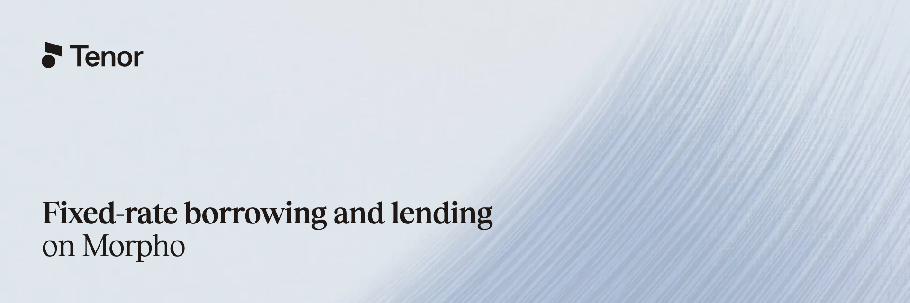

  

Tenor is non-custodial software for fixed-rate borrowing and lending on the Morpho protocol.

### Repositories

- [tenor-contracts](https://github.com/tenor-labs/tenor-contracts): contracts that extend the Morpho stack
- [tenor-api-clients](https://github.com/tenor-labs/tenor-api-clients): TypeScript and Python clients for the Tenor API
- [media-kit](https://github.com/tenor-labs/media-kit): logos in SVG and PNG

### Links

- [Website](https://tenor.finance/)
- [App](https://app.tenor.finance/)
- [Documentation](https://docs.tenor.finance/)
- [Blog](https://blog.tenor.finance/)
- [X](https://x.com/TenorFinance)
